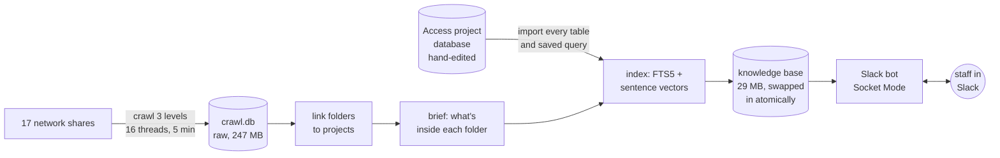
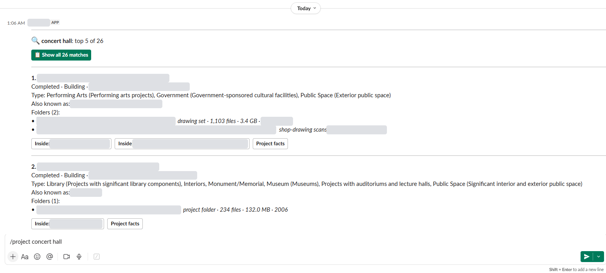
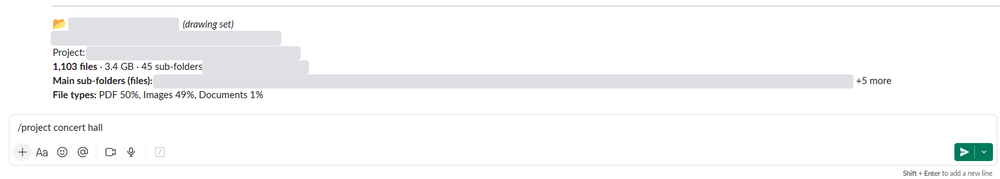

# Slack Archive Search

**A Slack bot that finds any project folder in about 12 TB of office archives and tells you what's inside, in under a second. It uses no LLM.**

I built it for the ~50 people in my office. Version 1 was mine alone: four weeks of spare-time work in notebooks, with a local LLM. People used it and liked it. Version 2 is a ground-up rebuild done in two days with an AI coding agent (Claude Code), and it went live for the office on the second day. I made the design calls; the agent did the analysis, the code, the tests and the docs. Version 2 is faster, more accurate, easier to run, and fully documented.

> This repository is a write-up, not the code. The bot runs on internal data, so the source stays private. Company names, server names, people and project names are removed or replaced with `[placeholders]`.

## At a glance
| | |
|---|---|
| Users | ~50 staff, in Slack. Live since 2026-11-03: 62 requests from 7 people on day one |
| Data | A hand-edited Access database (~570 projects, ~200 fields each) and a crawl of 17 network shares |
| Crawl | 373,833 folders, 2,573,898 files, 12.66 TB, read 3 levels deep in **5 minutes** (16 threads, metadata only) |
| Knowledge base | One 29 MB SQLite file: 2,159 searchable documents, 699 folders linked to 359 projects |
| Search | SQLite FTS5 keyword search + a local sentence model (all-MiniLM-L6-v2, ONNX, CPU), fused by reciprocal rank |
| LLM | **None**: every answer comes from the data |
| Code | ~2,000 lines of Python, plus 37 tests (~500 lines) that run against a fake Slack |
| Releases | v1.0.0, then 12 tagged v2 releases, each with a written note |
| Runs on | AWS EC2, Windows Server, Slack Socket Mode (no inbound ports) |

## The story in short
1. **v1 (May–June 2026, solo, spare time).** Two separate pipelines, one for the project database and one for the network folders. The LLM wrote SQL from questions and guessed a category for each folder from its name. Coworkers took it up for project lookups, fact sheets and FAQs, and it was well received. It also showed me what people actually asked for.
2. **What v1 taught me.** The LLM was the weakest part: it guessed, it was slow, and it needed a GPU machine. The two data sources were kept separate, and the data prep ran as notebook steps rather than one build.
3. **v2 (Nov 2026, with Claude Code).** I took the LLM out on purpose. The two sources are now merged at build time; the crawl goes 3 levels deep, and every folder gets a brief of what's inside. A rebuild takes one command, and 37 automated tests cover every Slack command and button.

Full story: [docs/story.md](docs/story.md).

## How it works

Design and search details: [docs/architecture.md](docs/architecture.md).

## What a user sees
`/project concert hall` in Slack. The word "concert" isn't in the top project's name; it ranks first because both the keyword and the meaning engines found it.

Pressing **Inside** shows what a folder holds without opening it:

Screenshots from the live bot. Project names, places, paths and the bot's internal name are masked. More examples and the test run are in [docs/evidence.md](docs/evidence.md).

## Built with an AI agent, under rules
The part I'm proudest of is the process, not the line count.
- **Rules file (`CLAUDE.md`).** Hard rules the agent must follow in every session: never modify the v1 folder; no LLM features; never record folders that refuse access; never start the live bot.
- **Handoff document.** Current state, decisions and next steps, so a new session (a person or an agent) can carry on with no chat history.
- **A note per release.** Each version records its goal, decisions and who made them, method, tools, measured results and next steps.
- **Prompt log.** Every request I made is kept word for word, with a short summary of what was done.

How that worked in practice, with real prompts: [docs/agentic-workflow.md](docs/agentic-workflow.md).

## In this repo
| File | What it covers |
|---|---|
| [docs/story.md](docs/story.md) | v1 → v2: what I built, what I learned, why I removed the LLM |
| [docs/architecture.md](docs/architecture.md) | Pipeline, data model, linking, briefs, hybrid search, trade-offs |
| [docs/evidence.md](docs/evidence.md) | Tests, measured build numbers, live usage, search examples |
| [docs/agentic-workflow.md](docs/agentic-workflow.md) | How I worked with Claude Code, with excerpts from the prompt log |
| [docs/releases.md](docs/releases.md) | Every release, v1.0.0 → v2.1.2 |

## Stack
Python 3.13 · Slack Bolt (Socket Mode) · SQLite + FTS5 · fastembed / ONNX Runtime (all-MiniLM-L6-v2) · NumPy · RapidFuzz · pyodbc (Access) · pytest · Windows Server on AWS EC2 · Claude Code

*Author: Xiao Qin*
