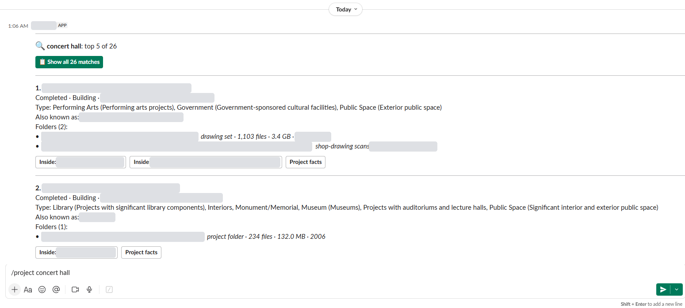
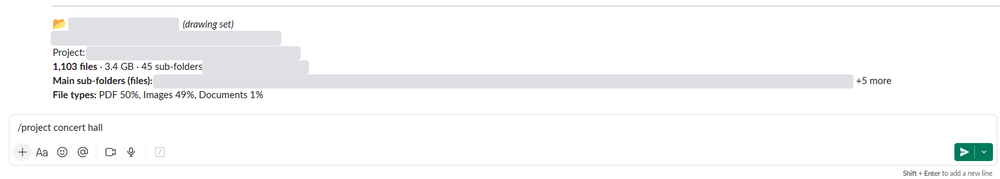

# Evidence that it works

Everything here comes from the real system: test runs, build logs and activity logs. Company, server, people and project names are replaced with `[placeholders]`; the numbers are unchanged.

## 1. Automated tests: 37 passed
Run on the build PC on 2026-11-04 (`pytest -v`). The Slack tests run real Slack Bolt routing against a local fake Slack, so they never touch the live workspace or the real token.
```text
platform win32 -- Python 3.13.15, pytest-9.2.0, pluggy-1.7.0
collected 37 items

tests/test_activity.py::test_report_summary_bugs_csv PASSED
tests/test_activity.py::test_no_log_yet PASSED
tests/test_bot.py::test_project_number PASSED
tests/test_bot.py::test_project_default_has_big_show_all_button PASSED
tests/test_bot.py::test_project_few_results_no_show_all_button PASSED
tests/test_bot.py::test_show_all_button_lists_everything PASSED
tests/test_bot.py::test_old_all_flag_still_lists_everything[-all museum] PASSED
tests/test_bot.py::test_old_all_flag_still_lists_everything[museum -all] PASSED
tests/test_bot.py::test_old_all_flag_still_lists_everything[--all museum] PASSED
tests/test_bot.py::test_old_all_flag_still_lists_everything[\u2014all museum] PASSED
tests/test_bot.py::test_old_all_flag_still_lists_everything[MUSEUM -ALL] PASSED
tests/test_bot.py::test_old_all_flag_still_lists_everything[museum -a] PASSED
tests/test_bot.py::test_project_empty_shows_examples PASSED
tests/test_bot.py::test_project_no_results_and_operators PASSED
tests/test_bot.py::test_brief_button PASSED
tests/test_bot.py::test_pfacts PASSED
tests/test_bot.py::test_faq PASSED
tests/test_bot.py::test_dm_only PASSED
tests/test_bot.py::test_purge_only_in_dm PASSED
tests/test_docs.py::test_links_and_anchors PASSED
tests/test_kb.py::test_parse_number PASSED
tests/test_kb.py::test_roles PASSED
tests/test_kb.py::test_name_part_and_score PASSED
tests/test_kb.py::test_container PASSED
tests/test_link.py::test_review_list_rules PASSED
tests/test_link.py::test_overrides_link_unlink_and_clear_review PASSED
tests/test_slack_routing.py::test_project_command_posts_blocks_with_buttons PASSED
tests/test_slack_routing.py::test_inside_button_is_routed PASSED
tests/test_slack_routing.py::test_facts_button_uploads PASSED
tests/test_slack_routing.py::test_other_commands_route PASSED
tests/test_slack_routing.py::test_dm_text_gets_hint_group_dm_does_not PASSED
tests/test_slack_routing.py::test_purge_deletes_all_bot_messages_and_files_no_confirmation PASSED
tests/test_slack_routing.py::test_show_all_button_is_routed PASSED
tests/test_slack_routing.py::test_every_command_is_logged PASSED
tests/test_slack_routing.py::test_time_zone_falls_back_instead_of_failing PASSED
tests/test_slack_routing.py::test_every_message_starts_with_a_divider PASSED
tests/test_slack_routing.py::test_data_with_angle_brackets_is_escaped PASSED

============================= 37 passed in 2.98s ==============================
```
`test_docs.py` checks that every link and anchor in the private repo's documentation still resolves.

## 2. Measured build (2026-11-03)
**Crawl:** 17 of 17 shares reachable.

| | |
|---|---:|
| Top-level folders | 1,281 |
| Folders | 373,833 |
| Files | 2,573,898 |
| Total size | 12.66 TB |
| Errors | 0 |
| Time | 308 s |

**Build:** 76 s; knowledge base 28.6 MB.

| | |
|---|---:|
| Searchable folders | 1,592 (321 found inside container folders) |
| Folders linked to projects | 699 → 359 projects |
| Search documents (each with a vector) | 2,159 |

How the 699 links were made:

| Method | Folders |
|---|---:|
| Project number | 556 |
| Fuzzy name | 85 |
| Folder name stored in the database | 29 |
| Alternate number | 29 |

## 3. Real usage
**v1** was in use from May to October 2026. `/project` was its most-used command, followed by `/query` and `/pfacts`.

**v2 went live for the office on 2026-11-03**, the same day it was built. Day one, from the admin activity report (`activity.bat`): **62 interactions from 7 people.**

| Command or button | Count |
|---|---:|
| `/project` | 16 |
| `/faq` | 14 |
| Direct messages to the bot (answered with a usage hint) | 7 |
| `/purge` | 6 |
| `/pfacts` | 6 |
| **Inside** button (folder brief) | 5 |
| **Show all N matches** button | 4 |
| **Project facts** button | 3 |

Every search command and every button was used on day one.

## 4. Search spot checks
| Query | Result |
|---|---|
| A bare project number | That project only, with its 3 folders |
| `concert hall` | A performing-arts project first, found by both engines. The word "concert" isn't in its name |
| `courthouse` | 4 courthouses and a proposal |
| `hospital in [city]` | 4 hospital projects in that city |
| `museum -all` (old v1 syntax) | Still works, and lists every match |
| FAQ: 27 sample questions | 25 find the right entry first |

## 5. A real reply (names replaced)
Screenshots from the live bot, with project names, places, paths and the bot's internal name masked:





The same reply as text, `/project concert hall`, top result:
```text
1. [####]  [project name]
   Completed · Building · [city]
   Type: Performing Arts, Public Space
   Folders (2):
   • \\[server]\[share]\[folder]   drawing set · 1,103 files · 3.4 GB
   • \\[server]\[share]\[folder]   shop-drawing scans
   [ Inside ]  [ Project facts ]
```
Pressing **Inside**:
```text
📂 [folder]  (drawing set)
1,103 files · 3.4 GB · 45 sub-folders
Main sub-folders (files): [sheet set] (148), [sheet set] (140), [sheet set] (114), +12 more
File types: PDF 50%, Images 49%, Documents 1%
```
A proposal folder found by keywords, from the same search:
```text
📂 [proposal name]  (proposal)
449 files · 1.2 GB · 44 sub-folders
Phases: Proposal/RFP
Main sub-folders (files): [precedents] (316), [team] (127), [issuances] (6)
File types: Images 84%, PDF 9%, Other 5%, Documents 1%
Has folders for: Presentations, Drawings
```
